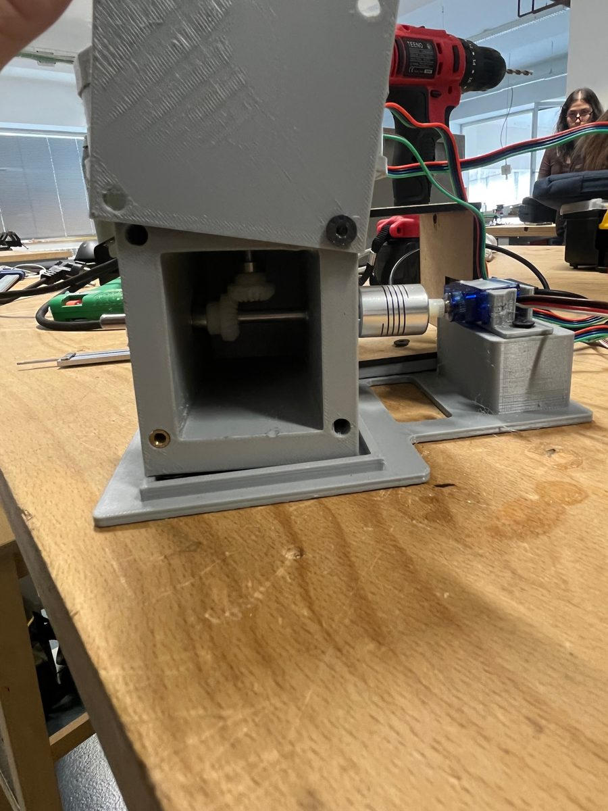
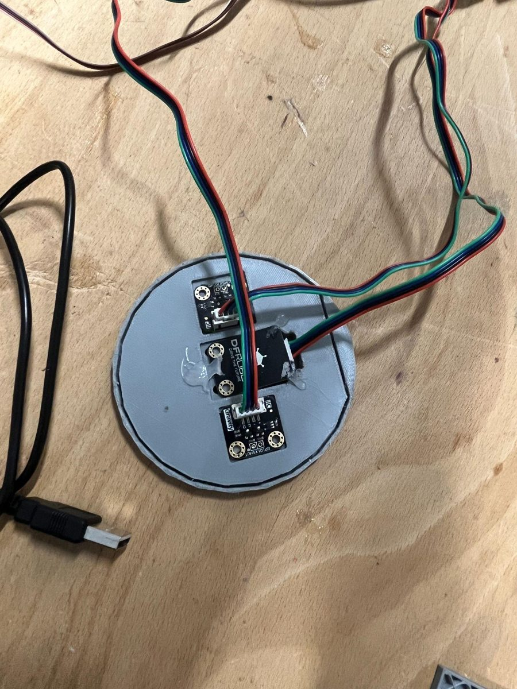
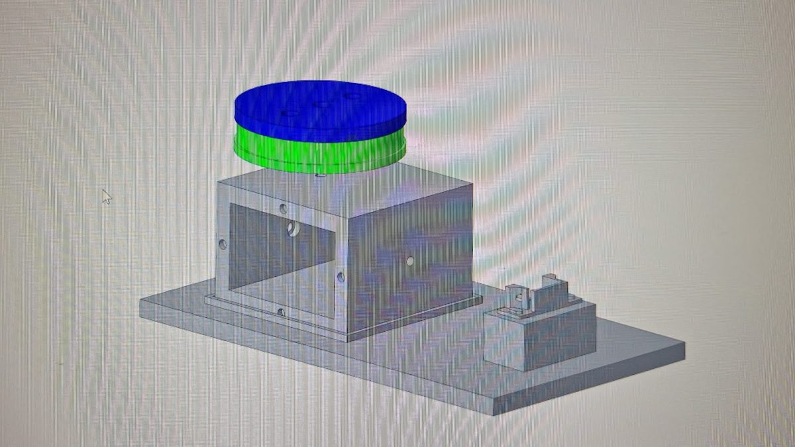
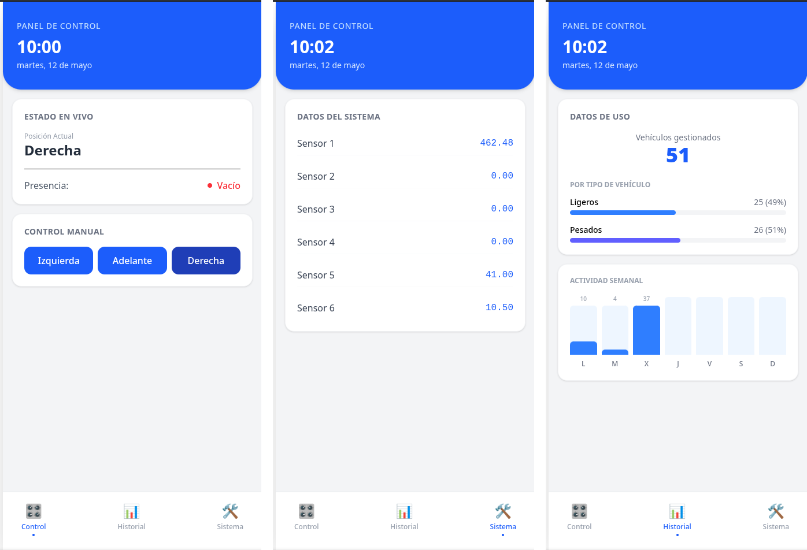
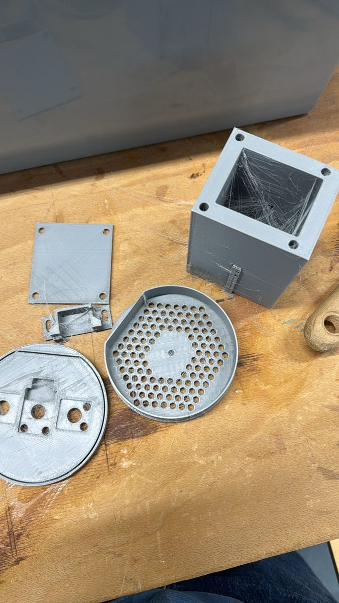
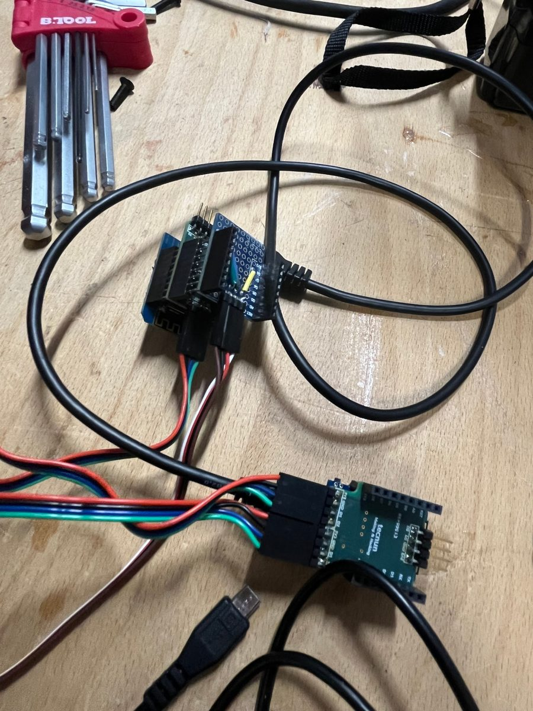
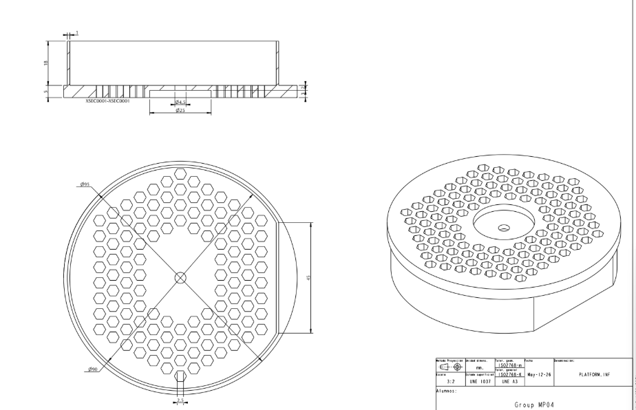
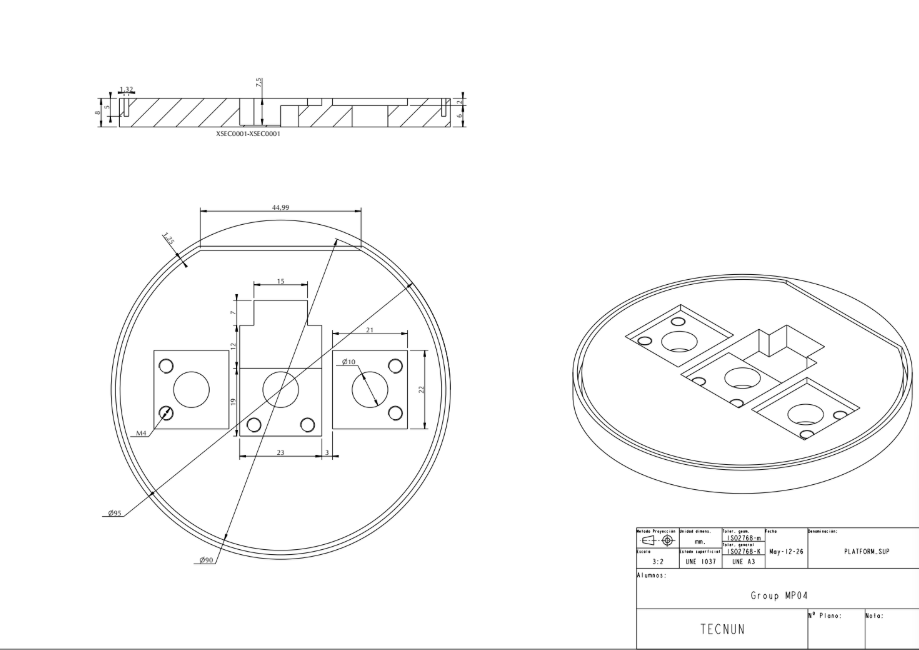

# Vehicle Sorting Platform

A rotating IoT platform that classifies toy vehicles by length (light or heavy) and turns them toward the matching exit. Two ESP8266 boards report to a FastAPI backend, which makes the decision and drives the servo. A React web app shows live state, statistics and manual controls.

*Making & Hacking mini-project, Team 4, Tecnun – Universidad de Navarra, May 2026.*

**Final code (firmware, backend, web app): [Asempere123123/making](https://github.com/Asempere123123/making)**, maintained by teammate Alejandro Sempere. This repository documents the project and keeps the first single-board prototype.

<p align="center">  </p>

## How it works

1. **Detect.** A VEML7700 lux sensor sits at the centre of the 100 mm platform. A car rolling on drops the reading sharply.
2. **Measure.** Two VL53L0X laser distance sensors, 70 mm apart, look up from the platform. A small car (50 mm) covers at most one of them. A large car (100 mm) covers both.
3. **Decide.** Both boards post their readings to the backend, which keeps a small state machine:

   | Condition | State | Servo |
   |---|---|---|
   | platform uncovered (lux high) | empty | 90° (centre) |
   | both distance sensors covered | **heavy** | 180° (right lane) |
   | otherwise | **light** | 0° (left lane) |

   The backend acts only when the state *changes*, so each vehicle is counted once. Totals, the light/heavy split and the vehicles per weekday are stored in SQLite.
4. **Sort.** The actuator board polls the backend every 500 ms and moves the SG90 servo. The servo drives a 90° bevel-gear stage that rotates the platform.
5. **Monitor.** The React web app (installable on a phone) shows the live state, the sensor values and vehicles processed (51 in the demo session), and has buttons for manual control.

<p align="center"></p>

## Design decisions

- **I²C address clash.** Both VL53L0X sensors boot at address `0x29`. The first prototype ran both sensors on one board and re-addressed them through their XSHUT pins (see `firmware/prototype_single_board`). The final build puts **one sensor on each ESP8266** instead, which is simpler and lets both read at the same time.
- **Classification on the server.** The prototype classified on the microcontroller and had two logic bugs (marked in its source). Moving the decision to the backend fixed them and means the thresholds can be tuned without re-flashing the boards.
- **Noise filtering.** The final firmware averages several distance samples per reading and discards out-of-range values. The lux sensor acts as a gate, so the distance sensors only count while something is on the platform.
- **Mechanics.** Servo → Ø5 mm horizontal shaft → POM bevel gears → vertical shaft → platform. The shafts run on 4 radial bearings plus an axial bearing that carries the platform's weight. Parts are 3D-printed in PLA, and the electronics sit in a laser-cut MDF box.

<p align="center"> </p>
<p align="center"> </p>

## This repository

```
firmware/prototype_single_board/   first version: both sensors + classification on one ESP8266 (superseded)
docs/images/                       CAD, technical drawings, build photos, dashboard
```

To flash the prototype, copy `secrets.example.h` to `secrets.h` (it is git-ignored) and set your Wi-Fi network and backend URL. It needs the ESP8266 core, DFRobot_VL53L0X, DFRobot_VEML7700 and Adafruit Unified Sensor.

## Team

| Member | Contribution |
|---|---|
| Alejandro Sempere | Electronics and software (firmware, FastAPI backend, React app, AWS deployment), final integration |
| Carlos Tesoriero | Initial solution design (sensor choice and detection algorithm), electronics and software, assembly, presentation |
| Clemens Wiltschko | Mechanical design: servo housing, platform, printing and assembly |
| Martin Picaza | Mechanism planning, turning platform and model cars, assembly |
| Daniel Ullán | Gearbox housing, base, laser-cut box, drawings |
